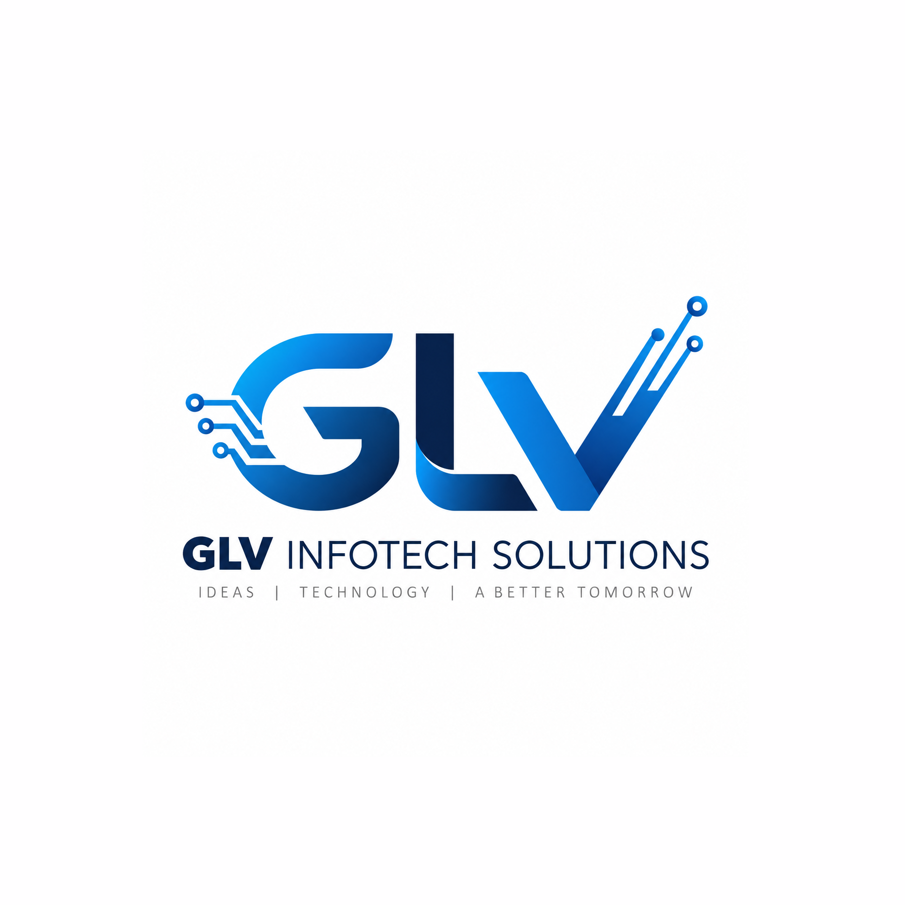
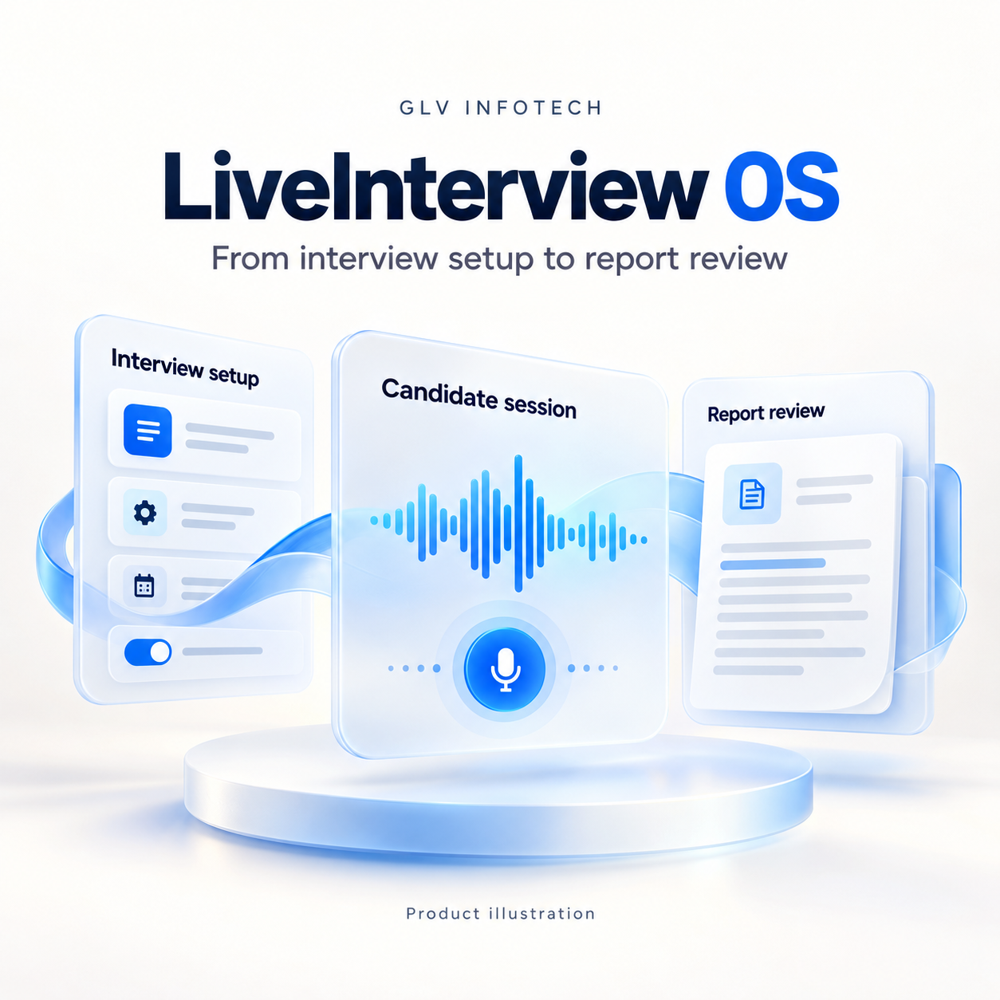
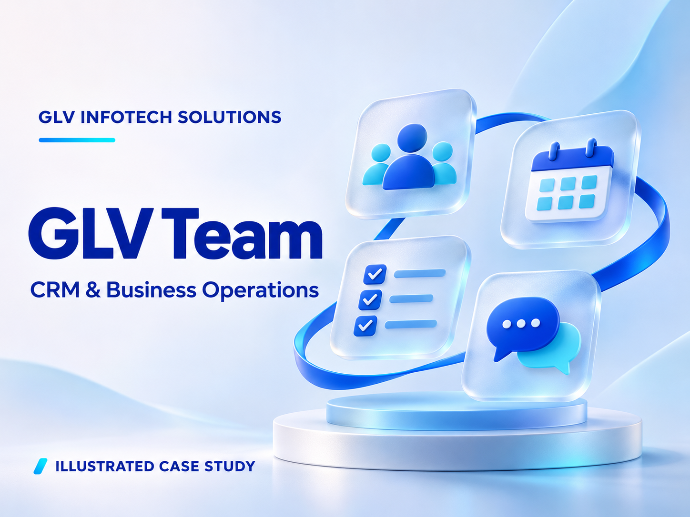
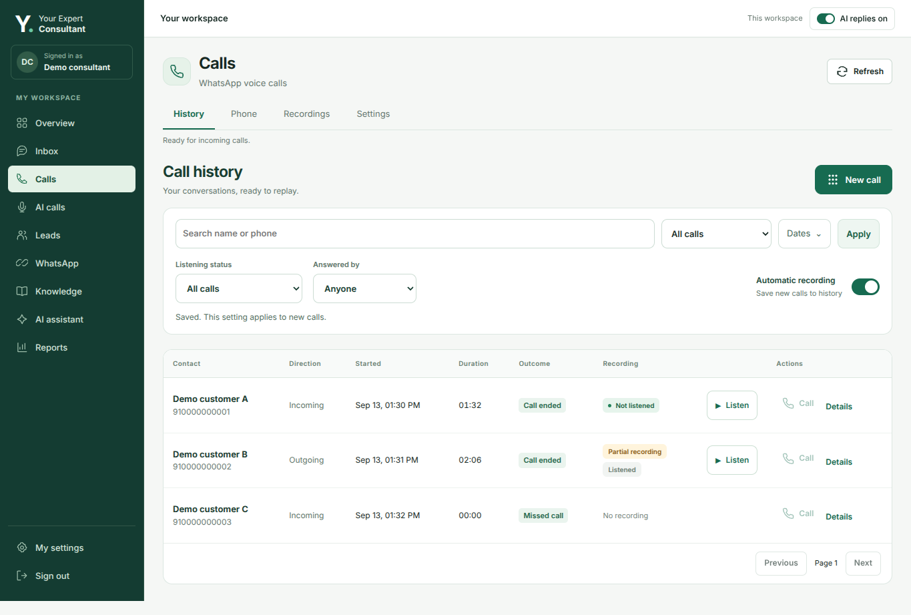
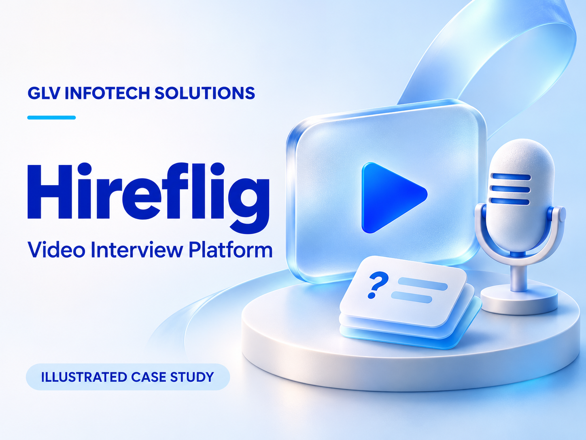
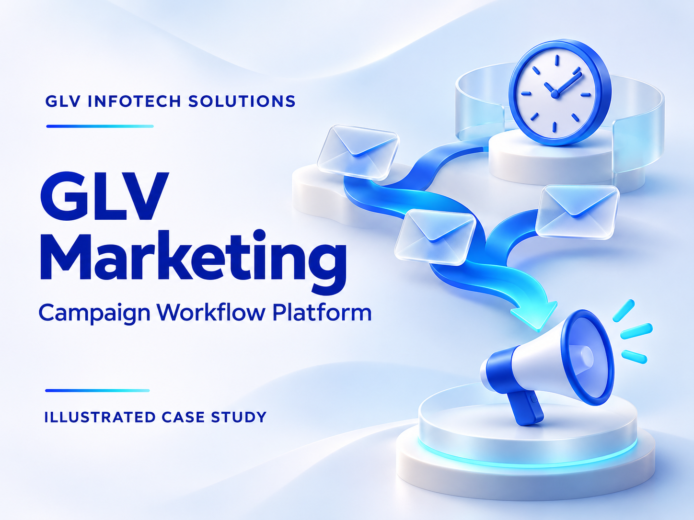
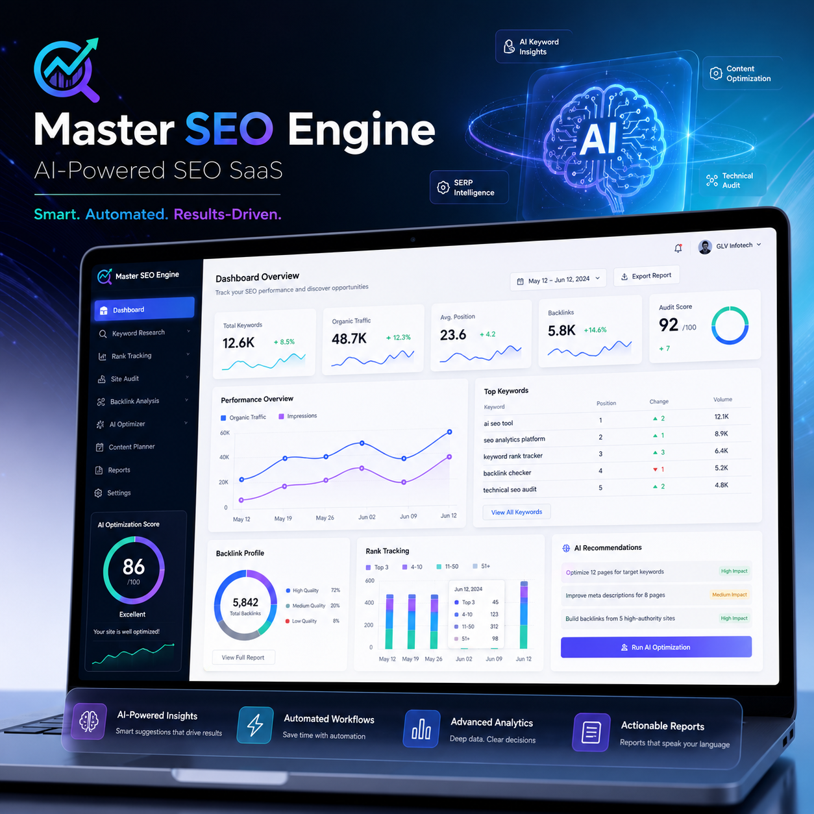
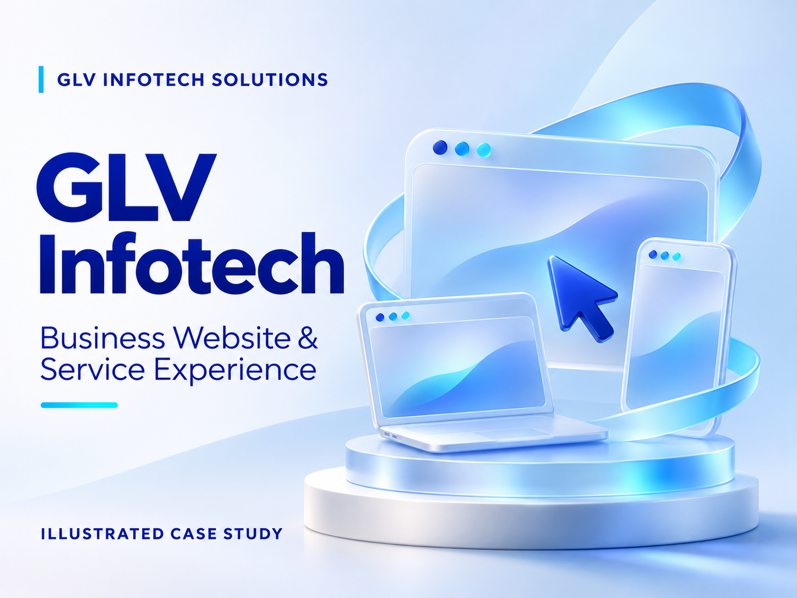

# Selected product work

This portfolio summarizes publicly described projects from GLV Infotech Solutions. My contribution is founder-led product planning, requirements, workflow design, UX direction and delivery coordination with our development team.

[View the illustrated portfolio on Upwork](https://www.upwork.com/freelancers/~01183a77d6d9886708) · [Back to profile](README.md)

## LiveInterview OS

**Recruitment SaaS · Company workspaces · Candidate-to-report workflow**

Hiring teams need to coordinate interview setup, candidate sessions and review. LiveInterview OS connects company roles, live digital interview experiences, transcripts and evaluation reports in a multi-company workspace.

**Workflow:** company setup and roles → candidate session → interview → transcript → evaluation and report review.

**My contribution:** requirements, workflow planning, UX direction and development delivery coordination. The product focus is practical administration and a clear review journey.

## GLV Team

**Workforce operations · CRM · HR and team workflows**

GLV Team brings projects, tasks, HR, attendance, payroll review, sales follow-ups and meetings into a connected internal workspace. Owner, manager and staff experiences organize responsibilities and access around the work each person needs to do.

**Product focus:** make daily tasks, employee administration and business follow-ups easier to understand and manage.

**My contribution:** product direction, operational requirements, interface review and delivery coordination with our team.

## WhatsApp AI CRM

**Shared inbox · Business knowledge · Human handover**

The CRM connects customer conversations, consultant ownership, business knowledge and document collection. AI-assisted replies support routine questions while staff can pause automation and take over a conversation.

**Workflow:** incoming conversation → ownership and context → assisted reply or staff handover → follow-up.

**My contribution:** requirements, workflow planning, UX direction and development coordination. Public previews use demo records; customer messages, documents and credentials are excluded.

## Hireflig

**One-way video interviews · Guided candidate experience**

Hireflig supports candidate invitations, question playback, thinking time, timed answers and submission. The administrative experience organizes interview settings, invitations and candidate progress.

**Product focus:** a straightforward candidate journey and clear interview administration.

**My contribution:** product requirements, candidate-flow planning, interface review and delivery coordination.

## GLV Marketing

**Campaign operations · Scheduling · Follow-ups and replies**

The platform organizes contact batches, campaign creation, mailbox selection, sending schedules, follow-ups and reply management.

**Product focus:** clear campaign controls and status, with fewer repetitive administration steps.

**My contribution:** workflow planning, requirements, UX review and coordination with the development team. Portfolio imagery is illustrative; it does not establish delivery-rate or revenue results.

## MasterSEOEngine

**SEO research · Prioritized work · Dashboard and reporting**

An SEO platform project designed to organize website analysis, keyword research, prioritized tasks and reporting across websites. The product direction connects research findings with actions a team can review and manage.

**My contribution:** product planning, dashboard direction, workflow structure and AI-assisted research planning.

The public dashboard visual is a product visualization. Its metrics are illustrative, not verified client results or a guarantee of rankings.

## GLV Infotech Website

**Business website · Service presentation · Enquiry journeys**

The company website presents GLV's services, products and portfolio in a responsive experience. It connects relevant service information with enquiry journeys for prospective clients.

**My contribution:** website strategy, content structure, UX review and development direction.

## Discuss a project

Share the current process, users and priorities through [Upwork](https://www.upwork.com/freelancers/~01183a77d6d9886708) or the [GLV Infotech Solutions website](https://www.glvinfotechsolutions.com).
