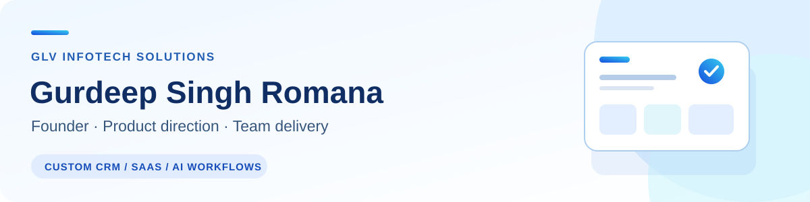
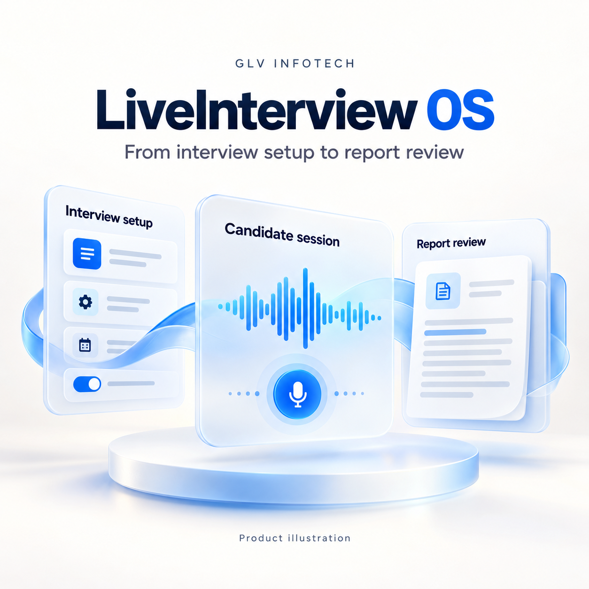
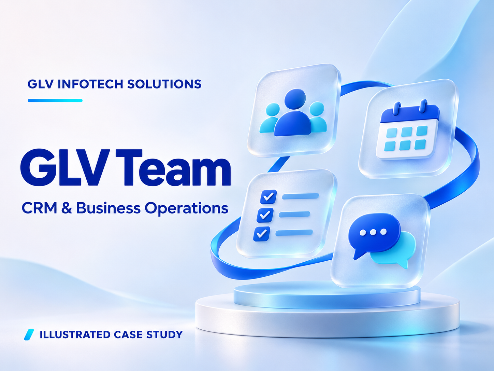
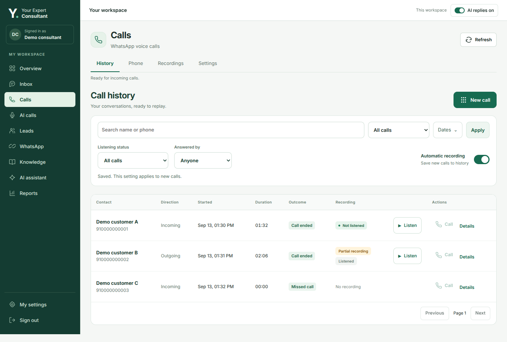
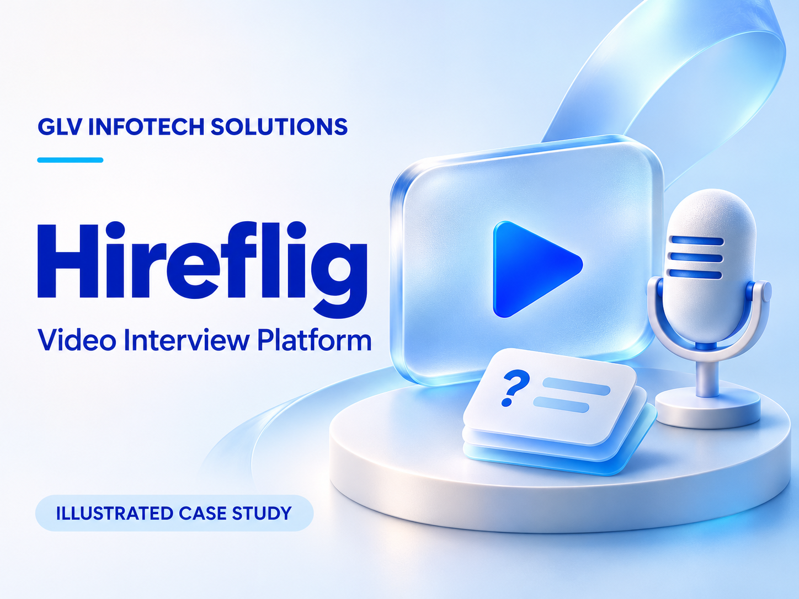
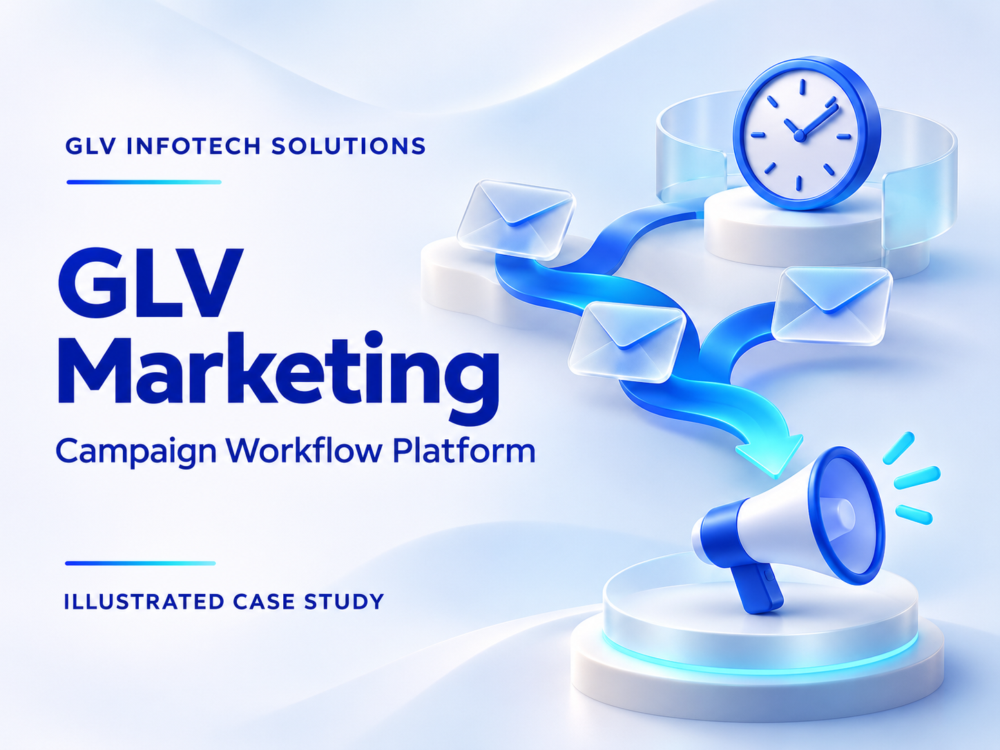
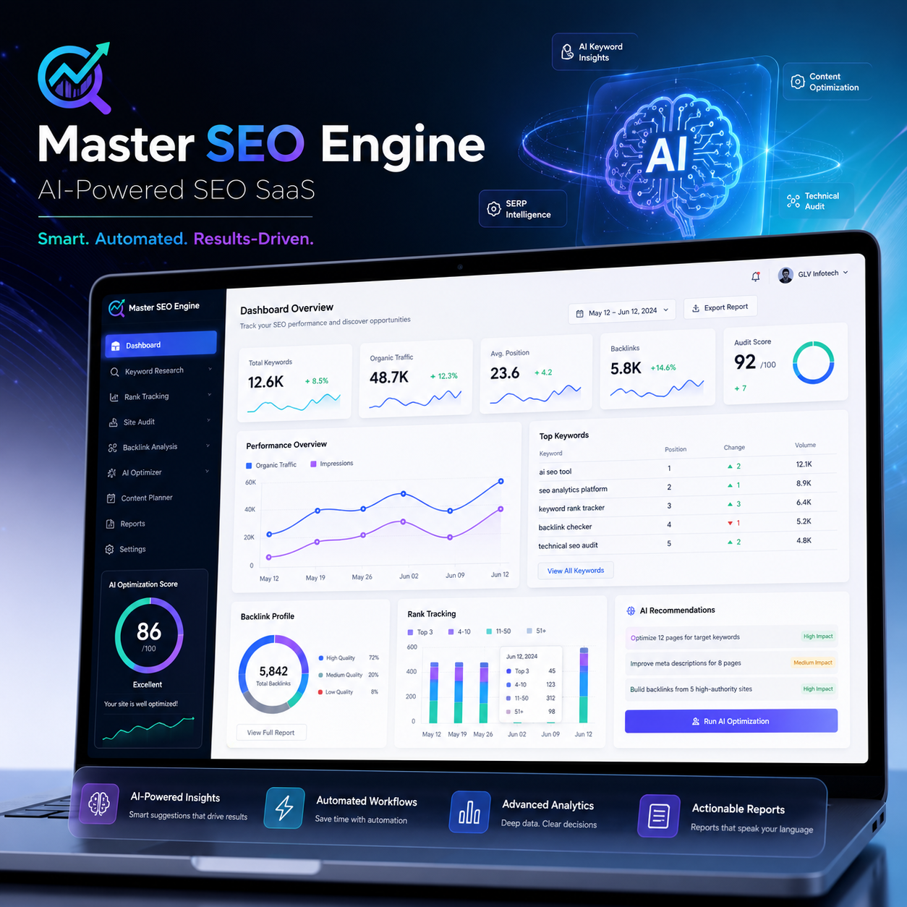
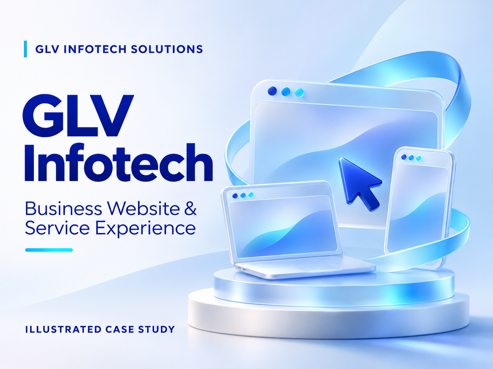
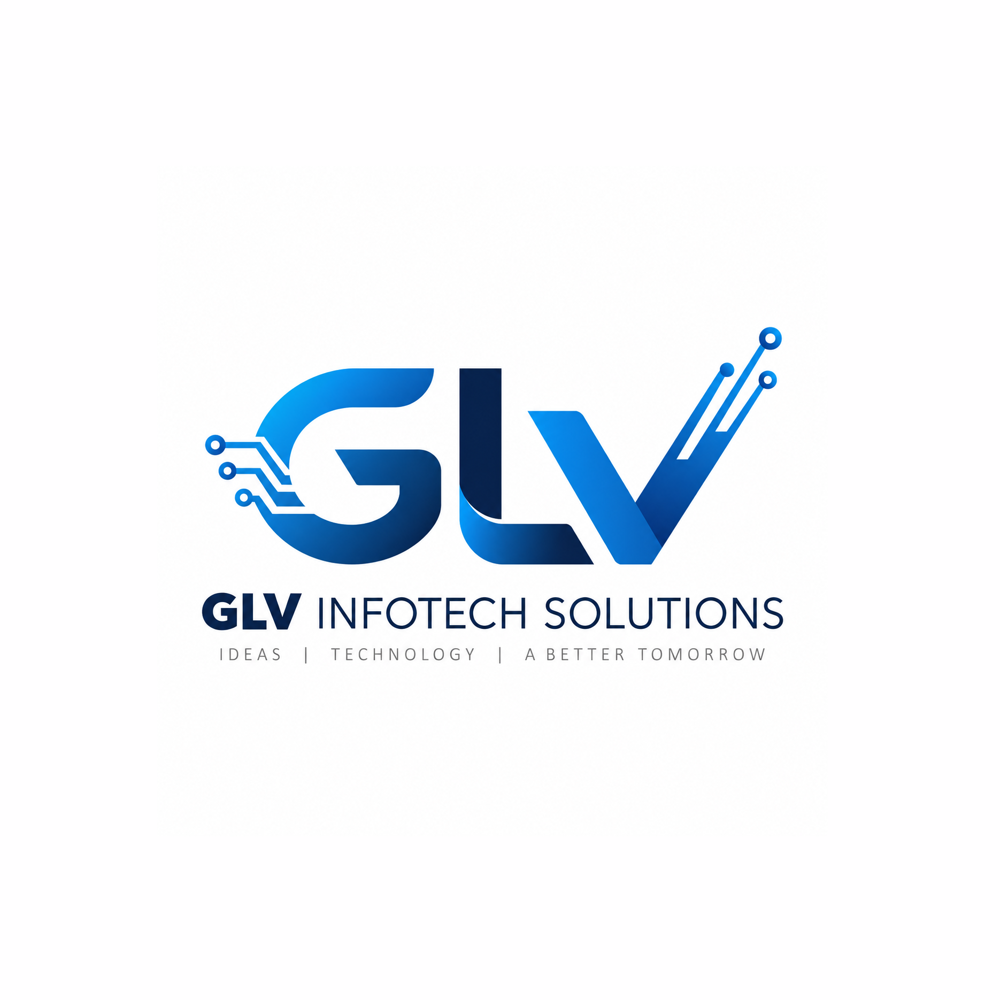

# Business software, shaped around real workflows

I'm **Gurdeep Singh Romana**, founder of **GLV Infotech Solutions Pvt. Ltd.** in Zirakpur, Punjab, India.

I lead product planning, client communication and delivery for custom CRM systems, SaaS platforms and AI-assisted business applications. I work with our development team across requirements, workflow design, interfaces and integrations.

[**Company website**](https://www.glvinfotechsolutions.com) · [**Upwork portfolio**](https://www.upwork.com/freelancers/~01183a77d6d9886708) · [**Stack Overflow**](https://stackoverflow.com/users/33316686/gurdeep-singh-romana)

---

## What I help build

| Area | Practical focus |
| --- | --- |
| **Custom CRM** | Shared conversations, lead ownership, sales pipelines, follow-ups and reporting |
| **SaaS & business platforms** | Company workspaces, user roles, onboarding, dashboards and administration |
| **AI-assisted workflows** | Business knowledge, assisted replies, human review and handover |
| **Internal operations** | Workforce, projects, tasks, HR, attendance and team coordination |
| **Web & integrations** | Responsive websites, business portals, API connections and existing-system upgrades |

## Technologies and implementation focus

Our development work includes **JavaScript, React, Node.js and PHP**, alongside API integrations and business automation.

| Focus | What it supports |
| --- | --- |
| **Web application development** | Responsive interfaces, business portals and connected workflows |
| **API integration** | Moving information between business tools and customer communication systems |
| **SaaS application design** | Company workspaces, onboarding, user roles and access control |
| **AI workflow design** | Relevant business context, response review and human handover |
| **Quality and delivery** | Reproducible issues, reviewable milestones and complete user-journey checks |

## Selected product work

Seven projects from our public portfolio. Each case study explains the workflow and my role in product direction and team delivery.

<table>
<tr><td width="50%" valign="top"> <strong><a href="PORTFOLIO.md#liveinterview-os">LiveInterview OS</a></strong> Candidate sessions, interviews, transcripts and report review.</td><td width="50%" valign="top"> <strong><a href="PORTFOLIO.md#glv-team">GLV Team</a></strong> Workforce, HR, attendance, projects and sales follow-ups.</td></tr>
<tr><td width="50%" valign="top"> <strong><a href="PORTFOLIO.md#whatsapp-ai-crm">WhatsApp AI CRM</a></strong> Demo interface preview of the CRM communication workflow.</td><td width="50%" valign="top"> <strong><a href="PORTFOLIO.md#hireflig">Hireflig</a></strong> Guided video interviews and recruitment administration.</td></tr>
<tr><td width="50%" valign="top"> <strong><a href="PORTFOLIO.md#glv-marketing">GLV Marketing</a></strong> Campaigns, scheduling, follow-ups and reply management.</td><td width="50%" valign="top"> <strong><a href="PORTFOLIO.md#masterseoengine">MasterSEOEngine</a></strong> SEO research and reporting. Illustrative dashboard metrics.</td></tr>
<tr><td width="50%" valign="top"> <strong><a href="PORTFOLIO.md#glv-infotech-website">GLV Infotech Website</a></strong> Services, responsive layouts and enquiry journeys.</td><td valign="middle" align="center"> <strong>Ideas · Technology · A Better Tomorrow</strong></td></tr>
</table>

*Product visualizations and demo previews. Illustrated metrics are not verified client outcomes.*

[**Explore all seven case studies →**](PORTFOLIO.md)

## My role in delivery

I connect business requirements with the decisions a product needs: **who uses it, what happens next, who can access it and how information moves between systems.**

1. **Understand** the current process, users and priorities.
2. **Define** scope, workflows, permissions and integration points.
3. **Review** working features with the development team and incorporate feedback.
4. **Validate** the agreed journeys and prepare a clear handover.

My contribution is product leadership and delivery coordination with our team. This repository is a public portfolio overview; the individual case studies distinguish product scope and illustrative visuals from verified outcomes.

## Technical interests

API integration · Role-based applications · Customer communication · AI-assisted workflows · Human-in-the-loop systems · Practical UX · SaaS operations

I use Stack Overflow to investigate specific technical problems, learn from reproducible examples and share solutions I can verify.

## Work with me

For a new product or an upgrade to an existing system, share your current workflow, intended users and priorities.

[**Discuss your project on Upwork**](https://www.upwork.com/freelancers/~01183a77d6d9886708) · [**Explore GLV Infotech Solutions**](https://www.glvinfotechsolutions.com)
